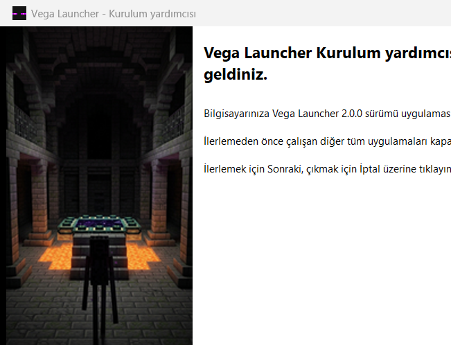

<div align="center">

# Vega Launcher

**A modern, custom Minecraft Launcher with built-in Modrinth integration, premium authentication, and local modpack support.**

[](https://github.com/Arcturus003/Vega-Launcher/releases/latest)
[](https://github.com/Arcturus003/Vega-Launcher/releases)
[](https://github.com/Arcturus003/Vega-Launcher/releases)
[](https://www.python.org/)

<br/>

<a href="https://github.com/Arcturus003/Vega-Launcher/releases/latest">
  
</a>

<br/><br/>

**Language / Dil:**  
[English](#-english) • [Türkçe](#-türkçe)

<br/>


</div>

---

<a name="-english"></a>
## 🇬🇧 English

Vega Launcher is an independent Minecraft client focused on performance, a clean dark aesthetic, and zero setup friction. It integrates directly with Modrinth and provisions Java automatically on fresh systems.

### Features

* **Automated Java Provisioning**: Vega Launcher checks your loader version (Java 8 for 1.16, Java 17 for 1.18–1.20.4, Java 21 for 1.20.5+) and downloads Mojang's official minimal JRE runtime automatically when needed. No manual JDK downloads or PATH variables required.
* **Modrinth Integration**: Search, filter, and install modpacks, individual mods, and shaderpacks directly inside the client. Supports Fabric, Quilt, Forge, and NeoForge loaders, with 1-click RAM presets (4 GB, 6 GB, 8 GB) and local `.mrpack` / `.zip` archive importing.
* **Obsidian & Void Aesthetics**: Dark surfaces with 5 selectable accent themes (*Electric Amethyst, Ender Pearl, Nether Crimson, Emerald Lush, Deep Dark*).
* **Smart Performance**: Ambient floating particles automatically suspend to 0% CPU and GPU usage when a game is running or when the launcher window is minimized.
* **Procedural Audio**: Real-time synthesized sound effects for buttons, switches, and launch events without external audio file bloat.
* **Security & Reliability**: Microsoft OAuth session tokens are encrypted at-rest using Windows DPAPI. Game profiles are isolated in their own folders, with transactional rollback backups during modpack updates.

### Quick Start

1. Download [`VegaLauncher_Setup_v2.0.0.exe`](https://github.com/Arcturus003/Vega-Launcher/releases/latest).
2. Run the installer and launch Vega Launcher.
3. Sign in with your Microsoft account, pick or create a profile, and click **Play**.

<div align="center">
  
</div>

### Building from Source

```powershell
# Clone the repository
git clone https://github.com/Arcturus003/Vega-Launcher.git
cd Vega-Launcher

# Set up virtual environment
python -m venv venv
.\venv\Scripts\activate

# Install dependencies
pip install -r requirements.txt

# Verify integrity and run
python integrity_check.py verify
python main.py
```

Run tests:
```powershell
python -m unittest discover tests
```

---

<a name="-türkçe"></a>
## 🇹🇷 Türkçe

Vega Launcher; oyuncuların Java yapılandırma karmaşasıyla uğraşmadan oyuna girebildiği, Modrinth arşivinden doğrudan mod ve modpack indirebildiği, koyu obsidyen ve ametist temalı masaüstü Minecraft başlatıcısıdır.

### Özellikler

* **Otomatik Java Sağlama**: Sisteminizde Java kurulu olmasa bile Vega Launcher seçtiğiniz Minecraft sürümünün ihtiyacını (1.16 için Java 8, 1.18–1.20.4 için Java 17, 1.20.5+ için Java 21) tespit eder ve Mojang'ın resmi mini-JRE çalışma zamanını otomatik olarak indirir.
* **Dahili Modrinth Tarayıcısı**: İstemci içinden modpack, mod ve shader arayıp tek tıkla kurabilirsiniz. Fabric, Quilt, Forge ve NeoForge desteği, hızlı RAM profilleri (4 GB, 6 GB, 8 GB) ve yerel `.mrpack` / `.zip` paketlerini içe aktarma desteği mevcuttur.
* **Obsidyen & Ametist Tasarımı**: Özel piksel simgeler ve tek tıkla değiştirilebilen 5 vurgu teması (*Elektrik Ametist, Ender İncisi, Nether Kızılı, Zümrüt Yeşili, Derin Karanlık*).
* **Akıllı Performans Modu**: Arayüzde süzülen parçacıklar oyun başladığında veya pencere simge durumuna küçültüldüğünde otomatik uykuya geçerek **%0 CPU/GPU** tüketir.
* **Prosedürel Ses Efektleri**: Buton, şalter, açılış ve seviye sesleri gerçek zamanlı frekans senteziyle üretilir; harici ses dosyası yükü oluşturmaz.
* **Güvenlik ve İzolasyon**: Microsoft OAuth oturum jetonları Windows DPAPI ile disk üzerinde şifrelenir. Her oyun profili bağımsız bir klasörde çalışır ve modpack güncellemelerinde otomatik yedekleme/geri alma koruması bulunur.

### Hızlı Başlangıç

1. **[VegaLauncher_Setup_v2.0.0.exe](https://github.com/Arcturus003/Vega-Launcher/releases/latest)** kurulum dosyasını indirin.
2. Kurulum sihirbazını tamamlayıp Vega Launcher'ı açın.
3. Microsoft hesabınızla giriş yapın, profilinizi seçin ve **Oyna** butonuna tıklayın.

### Kaynak Koddan Çalıştırma

```powershell
# Depoyu klonlayın
git clone https://github.com/Arcturus003/Vega-Launcher.git
cd Vega-Launcher

# Python sanal ortamı kurun ve etkinleştirin
python -m venv venv
.\venv\Scripts\activate

# Bağımlılıkları yükleyin
pip install -r requirements.txt

# Bütünlüğü doğrulayın ve başlatın
python integrity_check.py verify
python main.py
```

Testleri çalıştırmak için:
```powershell
python -m unittest discover tests
```

---

<div align="center">

Vega Launcher is an independent open-source project and is not affiliated with Mojang Studios or Microsoft.

</div>
