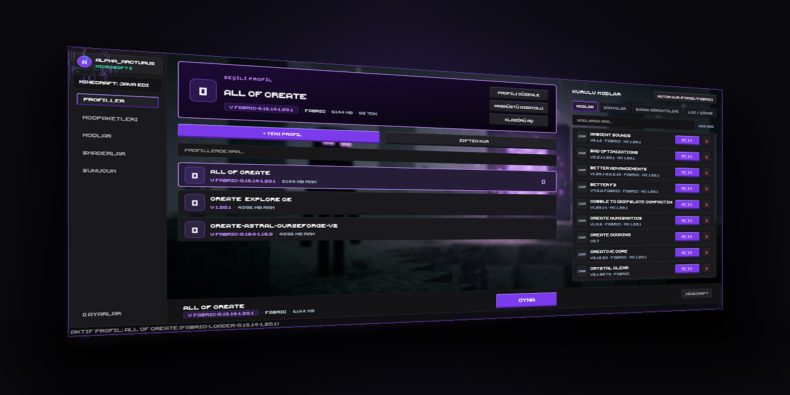

# Vega Launcher

Dahili Modrinth desteği, otomatik Java kurulumu ve profil izolasyonuna sahip hızlı ve sade masaüstü Minecraft başlatıcısı.

[](https://github.com/Arcturus003/Vega-Launcher/releases/latest)
[](https://github.com/Arcturus003/Vega-Launcher/actions)
[](https://github.com/Arcturus003/Vega-Launcher/releases)

[English](README.md) • Türkçe



## Özellikler

- **Dahili Modrinth Tarayıcısı**: Modpaketleri, modları ve shaderları tarayıcı açmadan doğrudan arayıp kurun.
- **Otomatik Java Kurulumu**: Sisteminizde Java bulunmasa dahi seçtiğiniz sürümün gerektirdiği resmi Mojang mini-JRE çalışma zamanını otomatik olarak indirir.
- **Yükleyici Desteği**: Fabric, Quilt, Forge ve NeoForge desteği.
- **Yerel Paket Yükleme**: Bilgisayarınızdaki `.mrpack` ve `.zip` dosyalarını tek tıkla içeri aktarın.
- **İzole Profiller**: Her profilin modları, kayıt dosyaları ve ayarları birbirinden tamamen bağımsız tutulur.
- **Güvenli Oturum**: Microsoft OAuth girişi ve yerel oturum jetonlarının Windows DPAPI ile şifrelenmesi.
- **Obsidyen Tema & Sesler**: Koyu obsidyen arayüz, özelleştirilebilir renk temaları ve prosedürel ses efektleri.

## Kurulum

En son kurulum paketini [Releases](https://github.com/Arcturus003/Vega-Launcher/releases/latest) sayfasından indirin:

👉 **[VegaLauncher_Setup_v2.0.0.exe İndir](https://github.com/Arcturus003/Vega-Launcher/releases/latest)**

Kurulumu tamamlayın, Microsoft hesabınızla giriş yapın ve oynamaya başlayın.

## Kaynak Koddan Çalıştırma

Gereksinimler: Windows üzerinde Python 3.12+.

```powershell
# Depoyu klonlayın
git clone https://github.com/Arcturus003/Vega-Launcher.git
cd Vega-Launcher

# Sanal ortamı oluşturun ve etkinleştirin
python -m venv venv
.\venv\Scripts\activate

# Bağımlılıkları yükleyin
pip install -r requirements.txt

# Başlatın
python integrity_check.py verify
python main.py
```

Testleri çalıştırmak için:
```powershell
python tests/run_tests.py
```

## Lisans

Tüm Hakları Saklıdır.
